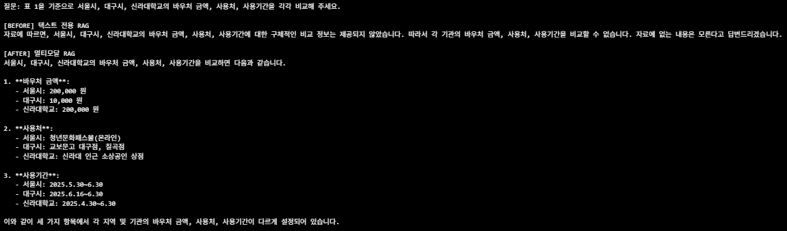
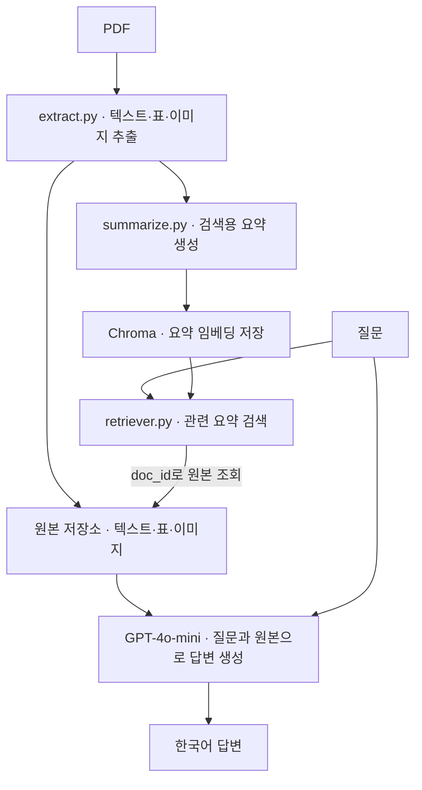

# Multimodal RAG

PDF의 텍스트·표·이미지를 함께 활용해 질문에 답하는 프로젝트입니다.

## 원본 데이터

- **자료:** 질병관리청 『손상예방과 건강한 안전사회』 2022년 4호
- **원본 PDF:** [질병관리청에서 다운로드](https://www.kdca.go.kr/sites/kdca/download/safeSociety/2022/2022%2B4%ED%98%B8.pdf)
- **사용 방법:** 다운로드한 PDF를 `data/document.pdf`로 저장합니다.

아래 Before / After는 이전 자료로 실행한 결과입니다.

## 1. Before / After

**질문**

> 표 1을 기준으로 서울시, 대구시, 신라대학교의 바우처 금액, 사용처, 사용기간을 각각 비교해 주세요.

| 구분 | 실행 결과 |
| --- | --- |
| Before · 텍스트 전용 RAG | 구체적인 비교 정보를 찾지 못해 답변하지 못함 |
| After · 멀티모달 RAG | 금액·사용처·사용기간을 항목별로 제시함 |

<!-- 비교 캡처를 docs/images/before-after.png로 저장하세요. -->


## 2. 아키텍처



요약본으로 검색하고, 같은 `doc_id`로 연결된 원본 자료를 가져와 답변합니다.
임베딩은 `text-embedding-3-small`, 요약과 답변 생성은 `gpt-4o-mini`를 사용합니다.

## 3. 프로젝트 구조

```text
multimodal-rag/
├── data/
│   ├── invest.pdf          # 원본 PDF
│   ├── figures/            # 추출 이미지
│   └── processed/          # 추출·요약 결과 (.pkl)
├── docs/images/            # README용 비교 캡처
├── practice/               # 단계별 연습 노트북
├── notebooks/              # 실습 노트북
├── src/
│   ├── extract.py          # 데이터 추출
│   ├── summarize.py        # 요약 생성
│   └── retriever.py        # 검색 및 최종 답변
├── .env.example            # 환경변수 예시
├── .gitignore
├── requirements.txt
├── requirements.lock.txt
└── README.md
```

## 4. 실행 방법

### 환경 준비 · Windows PowerShell

저장소를 내려받고 프로젝트 폴더에서 실행합니다.

```powershell
python -m venv .venv
.\.venv\Scripts\Activate.ps1
python -m pip install --upgrade pip
pip install -r requirements.txt
Copy-Item .env.example .env
```

`.env`에 실제 API 키를 입력하고, 원본 PDF를 `data/invest.pdf`에 넣습니다.
PDF 추출에는 **Poppler와 Tesseract** 설치 및 PATH 설정도 필요합니다.

```dotenv
OPENAI_API_KEY=your-api-key-here
```

### 순서대로 실행

```powershell
python src/extract.py
python src/summarize.py
python src/retriever.py
```

각 단계의 완료 메시지를 확인한 뒤 다음 단계를 실행합니다.
질문은 `src/retriever.py` 하단에 고정되어 있습니다.
요약·임베딩·답변 생성 시 OpenAI API 사용 비용이 발생합니다.

## 5. 설정 파일

| 파일 | 역할 |
| --- | --- |
| `.env` | 실제 API 키 저장 · Git 제외 |
| `.env.example` | 필요한 환경변수 안내 · 실제 키 없이 공유 |
| `.gitignore` | 가상환경·API 키·PDF·추출 이미지·처리 결과 등을 Git에서 제외 |

## 6. 트러블슈팅

| 증상 | 확인할 사항 |
| --- | --- |
| PowerShell 가상환경 활성화 거부 | 실행 정책 확인: `Set-ExecutionPolicy -Scope CurrentUser RemoteSigned` |
| `ModuleNotFoundError` | 가상환경 활성화 및 의존성 설치 확인 |
| VS Code에서 커널이 안 보임 | `.venv` 인터프리터 선택 후 커널 등록 |
| `PDFInfoNotInstalledError` | Poppler 설치 및 PATH 확인 후 터미널 재시작 |
| `TesseractNotFoundError` | Tesseract 설치 및 PATH 확인 후 터미널 재시작 |
| `extracted.pkl` 또는 `summaries.pkl`이 없음 | 앞 단계 실행이 완료되었는지 확인 |
